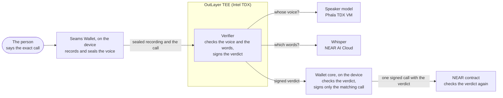
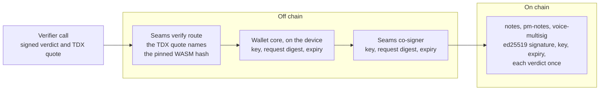

# Speak-to-Sign: a guide for judges

The shortest path to see that Speak-to-Sign works, and to check each claim.
[`README.md`](README.md) is the full reference. [`AGENTS.md`](AGENTS.md)
lists the facts that are easy to miss, and [`docs/README.md`](docs/README.md)
is the index of the specs: the threat model, the chain of trust and the live
state against the source.

## What it is

The owner of a NEAR account approves one exact call: they say one sentence,
for example "Send 2 NEAR to alice.testnet". Then:

1. A verifier checks two things: that the voice is the owner's voice, and
   that the heard words are the words of that call. The verifier runs in a
   TEE on OutLayer.
2. If both checks pass, the verifier signs a verdict: a short record that
   says "this voice said these words for this call". The verdict is valid
   for that one call only, and for 120 s only.
3. Seams Wallet core, the part of the Wallet that signs, checks the verdict.
   It signs the call only with a verdict for that call. Three contracts
   check the verdict again on chain.



Testnet only. [`docs/architecture.md`](docs/architecture.md) has the full
diagrams: the parts, enrollment, verification and the path of the audio.

The terms:

- **OutLayer** is a NEAR service that runs code off chain.
- **A TEE** (trusted execution environment) is a sealed part of a processor
  that the host cannot read or change. An **attested** TEE can prove which
  code runs in it.
- **The request digest** is the SHA-256 hash of the exact call. The verdict
  holds it.
- **Wallet core** is the npm dependency `@seams/wallet` 0.70.6, which the
  demo pins in `demo/frontend/package.json`. Its source is
  [`seams-wallet` at 0.70.6](https://github.com/seams-tech/seams-wallet/tree/66d831e007dd4d5faee6c189251d2d1463e2eebc).
  Every command below needs only this repo.

## See it in 2 minutes

You need a browser with passkeys and a microphone.

1. Open <https://speak-to-sign.pages.dev/>.
2. Do the three setup steps: **Create a wallet** (a passkey), **Set up your
   voice** (three short clips) and **Testnet NEAR and USDC** (the faucet).
3. Turn on the voice bar at the foot of the timeline (**Turn voice commands
   on**). Say "show me the open markets", then "bet one dollar on no on the
   second note". JEV opens the bet sheet. Read the bet aloud. The
   market contract `pm-notes.seams-v1.testnet` checks the verdict on chain
   and takes the USDC. If no market is open, say "open a market on the first
   note" first. Without the voice bar, press **Bet** on a post.
4. On a post, press **Write a note**. NEAR AI has drafted the note: the
   dialog says "Drafted by NEAR AI" under it. Read its summary aloud. The
   Wallet signs `add_note` on `notes.seams-v1.testnet` from your account, and
   the contract checks the verdict on chain.
5. To see a refusal, read a different summary, or add or drop a "not". The
   card shows the reason and the words that the verifier heard. Nothing is
   signed.

| Item       | Link                                             |
| ---------- | ------------------------------------------------ |
| Demo video | TODO: the owner adds the link to the demo video. |
| X post     | TODO: the owner adds the link to the X post.     |

## Why it is useful

Each use case below says what works today and what is not done yet.

### 1. Voice-agent payments and hands-free finance: the spoken sentence is the approval

People now give spoken commands to AI assistants, and these assistants
start to handle money. Before money moves, a person must approve the exact
call. Today this approval is a prompt. Many prompts in a row cause approval
fatigue: people click "approve" and do not read.

With Speak-to-Sign, the AI does the routine work: it drafts the note and
routes the spoken command to the right sheet. The AI never proposes or signs
a payment. The person decides when they say the exact call. The sentence
states the intent ("send 2 NEAR to alice.testnet"), and the voice shows who
said it. Nothing signs the call without a verdict for that exact call. The
person does not type, and does not click through a prompt.

**Today, in the community notes app** (the main page of the demo site):

- **AI routes the command, and signs nothing.** In the voice bar, the person
  says what to do, for example "bet one dollar on no on the second note".
  JEV, an AI classifier, turns the words into a command: the post, the side
  and the amount. The command opens the bet sheet, a note or a rating. JEV
  does not propose a payment, and it signs nothing.
- **The person approves the exact bet by voice.** The person says the
  sentence that the bet sheet shows, for example "Bet 1 USDC no on market 12"
  (the sheet gives the number of the market). The verifier checks the voice
  and the words. The market contract takes the USDC only with the verdict of
  that bet. A refused bet fails, and the USDC goes back.
- **AI drafts the note, and the person approves it.** NEAR AI drafts a note
  for each post, and the Seams server writes a short summary of it. The
  person approves the note when they read the summary aloud. The write
  dialog says "Drafted by NEAR AI" under a note that the model wrote.

**Today, speak to pay** (`demo/speak-to-pay/`, a page that you run on your
machine): the person says the payment, and the Wallet pays one exact amount
to one exact account. Above 10 NEAR, the verifier asks for a passkey too
(`step_up`).

**Not done:**

- No policy lets software spend a small amount without a spoken approval.
- Speak to pay has no AI step: the person says the payment directly.
- If NEAR AI gives no valid note for a post, the post gets a template of its
  subject, with no "Drafted by NEAR AI" line. The site asks NEAR AI again at
  a later refresh, 3 times at most.
- The voice bar uses the speech recognition of the browser (Chrome and
  Safari, not Firefox).

### 2. Spoken multisig: signers know what they sign

Multisig transactions are hard to read, and signing them is tedious, so
signers often sign blind. On 21 February 2025, attackers took about
US$1.5 billion from Bybit. They changed the Safe{Wallet} page, and the
signers approved a transaction that they did not see. When each signer reads
the request aloud, the signer hears what they approve. The verifier checks
the heard words against the request that is signed, so the words on a
changed page do not match.

**Today:**

- `demo/contracts/voice-multisig/` (version 3.0.0) is voice only: M of N
  signers and no admin.
- A signer proposes a transfer, or the hide of a note, by voice. Each other
  signer says the same proposal from memory, and approves with a verdict of
  its own (the verifier's `multisig_confirm`).
- The contract checks each verdict on chain: key, expiry, owner, commitment.
  One recording counts once, and no call without a verdict can approve. The
  unit tests and a local nearcore sandbox test show this.
- It is on `voice-multisig.seams-v1.testnet` since 2026-11-12, with 2 of 2
  signers, and SourceScan verified its code.
- The notes contract names this multisig as its moderator. So the hide of a
  note needs a proposal that 2 of 2 signers approve by voice.

**Live run:** on 2026-11-12 two persons proposed and approved one transfer
by voice on `voice-multisig-2.seams-v1.testnet`, which runs the same build.
Each transaction holds the signed verdict. The contract then executed the
transfer of 0.1 NEAR. The transactions are in
[the contract README](demo/contracts/voice-multisig/README.md#live-run-on-testnet).

**Not done:**

- The signers are fixed at `new`: a voice-approved change of the signers
  does not exist yet.
- The notes account still has a full-access key (see
  [Not covered](#not-covered)).

### 3. Voice-gated contracts: a key alone cannot move state

A smart contract normally sees only a key signature. It cannot tell if a
person or a script sent the call. Here three contracts check the verdict of
the OutLayer TEE on chain, with the crate `seams-voice-verdict`:

| Contract | What needs a verdict |
| --- | --- |
| `notes.seams-v1.testnet` | Each note and each rating |
| `pm-notes.seams-v1.testnet` | Each bet: the bettor, the market, the side and the amount |
| `voice-multisig.seams-v1.testnet` | Each proposal and each approval |

Each contract checks the ed25519 signature against the pinned key, the
expiry, and that the verdict is for this exact action. Each verdict counts
once. So a bot with a plain NEAR key outside Seams Wallet cannot post a
note, rate, bet or approve over RPC without a new spoken verdict.

## How it differs

Many entries guard agent spending with caps, allowlists, policy contracts or
an AI judge. A large payment then waits for a person's tap. A tap shows only
that a device approved something, not what the person read.

In Speak-to-Sign, the approval itself is the spoken exact call. An attested
verifier checks the voice and the heard words, and binds both to the digest
of the request. Three contracts check that verdict on chain
([use case 3](#3-voice-gated-contracts-a-key-alone-cannot-move-state)).

Where other entries confirm by voice, the confirmation is a spoken "yes":
nothing checks who spoke, or binds the words to the call.

## Questions a judge asks

[`docs/judge-questions.md`](docs/judge-questions.md) answers each question
with the evidence. In short:

- **Voice can be cloned.** A clone alone gets nothing. The keys stay on the
  person's device, and voice unlock is bound to that device. A NEAR transfer
  above 10 NEAR also needs a passkey.
- **A changed page or an injected agent** needs no clone, and it fails. The
  person must say the exact call aloud, and the verifier refuses other words.
- **JEV approves nothing.** It classifies the spoken command and opens the
  sheet. The person approves the exact call by voice.
- **Spend guards** decide when a person must approve. Speak-to-Sign makes
  that approval show what the person meant.
- **Who controls the verifier.** The verdict key names the OutLayer project,
  not the build. So two layers check a verdict:
  - **Off chain,** the Seams verify route checks the TDX quote of the
    verifier call against the pinned WASM hash (`seams-wallet` `0b297e976`),
    and the threshold co-signer signs only with a verdict for the call. This
    check costs no gas. It also guards a native NEAR transfer
    (`demo/speak-to-pay`), which has no contract code on the receiver.
  - **On chain,** the three contracts check the ed25519 verdict, so a plain
    NEAR key outside Seams Wallet cannot skip the voice rule.

  See [spec 9](docs/voice-intents-spec.md#9-who-checks-the-verdict) and
  [spec 9.1](docs/voice-intents-spec.md#91-the-verdict-key-and-the-tdx-quote).

The checks of one verdict, in order:



## Check it from a terminal

You need `git`, `curl`, `jq`, Rust from rustup (it installs the pinned
toolchains), Node 24 with pnpm (`corepack enable`) for check 2, and Docker for
check 3. Run each command from
the folder that holds the clone. The `# See:` line above each command is the
result of a run on 2026-11-12 (macOS, arm64).

```bash
git clone https://github.com/seams-tech/speak-to-sign
```

1. The tests. The sandbox test downloads a nearcore sandbox on its first run.

   ```bash
   # See: 9 "ok" lines, 39 passed. The golden vectors match the code.
   (cd speak-to-sign/crates/spoken-intent && cargo test 2>&1 | grep 'test result')
   # See: 9 "ok" lines, 140 passed.
   (cd speak-to-sign/crates/voice-verifier && cargo test 2>&1 | grep 'test result')
   # See: 7 notes:: tests ok, the summary rules of docs/terminal-checks.md step 2.
   (cd speak-to-sign/crates/voice-verifier && cargo test --test ops notes:: 2>&1 | grep '^test')
   # See: 47 passed.
   (cd speak-to-sign/demo/contracts/community-notes && cargo test -p community-notes 2>&1 | grep 'test result')
   # See: 4 tests ok in a local nearcore sandbox, after build.sh makes the WASM.
   # One of them is the_moderator_hides_a_note.
   (cd speak-to-sign/demo/contracts/community-notes && ./build.sh > /dev/null 2>&1 && cargo test -p community-notes-sandbox 2>&1 | grep '^test ')
   # See: 19 passed. The multisig contract refuses each bad verdict on chain.
   (cd speak-to-sign/demo/contracts/voice-multisig && cargo test verdict 2>&1 | grep 'test result')
   # See: 14 passed. Each approval is a verdict of its own signer, from a new recording.
   (cd speak-to-sign/demo/contracts/voice-multisig && cargo test approv 2>&1 | grep 'test result')
   ```

2. The verdict check. `@seams/voice-verdict` (`packages/voice-verdict/`)
   checks a signed verdict before anything is signed: the pinned key, the
   signature, the fields, the expiry, and the request and sentence digests.

   ```bash
   # See: 6 lines that start with "✔ a", then "ℹ pass 56" and "ℹ fail 0".
   # One line: "a verdict for one community note does not pass for another note".
   (cd speak-to-sign/packages/voice-verdict && pnpm install --frozen-lockfile >/dev/null && pnpm test 2>&1 | grep -E '^✔ a (step-up |verdict)|^ℹ (pass|fail)' | sed 's/ ([0-9.]*ms)//')
   ```

3. The active verifier comes from this source. Build commit `62cd438` in
   Docker, then read the active version on OutLayer.

   ```bash
   # See: sha256 1e7c6968bbfcf6d3193874d12988054114a004f7e10ccf8c1aeddfdca6d38a5c
   (cd speak-to-sign && git checkout --quiet 62cd438 && crates/voice-verifier/build.sh --docker 2>&1 | tail -1; git checkout --quiet dev)
   # See: the same hash (verifier 0.14.1).
   curl -s https://rpc.testnet.fastnear.com -H 'Content-Type: application/json' -d "{\"jsonrpc\":\"2.0\",\"id\":1,\"method\":\"query\",\"params\":{\"request_type\":\"call_function\",\"finality\":\"final\",\"account_id\":\"outlayer.testnet\",\"method_name\":\"get_project\",\"args_base64\":\"$(printf '%s' '{"project_id":"seams-v1.testnet/voice-verifier"}' | base64 | tr -d '\n')\"}}" | jq -r '.result.result | implode | fromjson | .active_version'
   ```

   The Seams staging server (a transfer, a note, a rating, a bet) and the
   demo route of the multisig page call this version.

4. The deployed notes contract is the reproducible build of commit `119ef0e`.

   ```bash
   # See: 724jz1XPE5sEQU8HXMXf4Ub1WWem8csJyhAKSeabtU7c
   curl -s https://rpc.testnet.fastnear.com -H 'Content-Type: application/json' -d '{"jsonrpc":"2.0","id":1,"method":"query","params":{"request_type":"view_account","finality":"final","account_id":"notes.seams-v1.testnet"}}' | jq -r .result.code_hash
   # See: git+https://github.com/seams-tech/speak-to-sign?rev=119ef0e6ceda8fedd131a8b4a7e6ce554b99751f
   curl -s https://rpc.testnet.fastnear.com -H 'Content-Type: application/json' -d '{"jsonrpc":"2.0","id":1,"method":"query","params":{"request_type":"call_function","finality":"final","account_id":"notes.seams-v1.testnet","method_name":"contract_source_metadata","args_base64":"e30="}}' | jq -r '.result.result | implode | fromjson | .build_info.source_code_snapshot'
   ```

   The code hash is the base58 form of the SHA-256 `596beeb3…d9c3` in
   `demo/contracts/community-notes/reproducible.sha256`, the reproducible
   build of `119ef0e`. SourceScan built that commit again and got the same
   code hash, so NearBlocks shows the code as verified
   (<https://testnet.nearblocks.io/address/notes.seams-v1.testnet/contract>).
   To build it yourself, see step 4 of `docs/terminal-checks.md` (Docker and cargo-near 0.22.0). Of
   the other three demo contracts, the note market and the faucet run builds
   of `777b844`, and the voice multisig runs the build of `99231f6`.
   SourceScan verified all of them (`demo/contracts/README.md`).

5. NEAR AI publishes an attestation report for its Whisper model: an Intel
   TDX quote of the Whisper VM, with NVIDIA GPU evidence, and a quote of its
   gateway. The first command shows only that the report has them. The second
   command runs the verifier's own check of the two quotes on a recorded
   report, with Intel's recorded collateral, and compares that check with
   `dcap-qvl`. The check is in verifier 0.14.1, the active version: see
   [`docs/trust-chain.md`](docs/trust-chain.md#the-near-ai-check).

   ```bash
   # See: openai/whisper-large-v3: Intel TDX quote true, NVIDIA GPU evidence true
   curl -s "https://cloud-api.near.ai/v1/attestation/report?model=openai/whisper-large-v3" | jq -r '.model_attestations[0] | "\(.model_name): Intel TDX quote \(.intel_quote|length > 0), NVIDIA GPU evidence \(.nvidia_payload|length > 0)"'
   # See: 2 lines "test result: ok." with 10 passed and 5 passed (the first run also compiles the crate)
   (cd speak-to-sign/crates/voice-verifier && cargo test --test nearai_attestation --test tdx_quote 2>&1 | grep "^test result")
   ```

## Claim -> where to check it

"Spec" is [`docs/voice-intents-spec.md`](docs/voice-intents-spec.md).

| Claim | Where |
| ----- | ----- |
| One crate makes the sentence and the request digest; the golden file matches the code. | `committed_spoken_intent_vectors_match_generator` in `crates/spoken-intent/tests/vectors.rs`; spec section 4 |
| An added or dropped "not" is refused. One changed or dropped word in a summary of 4 words or more passes. | `verify_accepts_a_spoken_note_summary` in `crates/voice-verifier/tests/ops/notes.rs`; rule `words_pass` in `crates/voice-verifier/src/words.rs`; spec 7.2 |
| Another voice is refused (cosine below 0.45). | `verify_refuses_another_speaker` in `crates/voice-verifier/tests/ops/verify.rs` |
| The speaker key comes from a TDX attestation, and a reply that fails its signature is refused. | `SPEAKER_PINNED_KEY_HEX` in `crates/voice-verifier/src/config.rs`; `verify_refuses_a_speaker_reply_that_fails_its_signature`; spec 7.1 |
| Each recording passes one time, also after a refusal. | `verify_refuses_other_words_and_uses_the_audio`; spec section 5 |
| A voice payment above 10 NEAR needs a passkey too (`step_up`). | `verify_steps_up_above_ten_near`; spec 7.3 |
| The verifier signs fixed verdict vectors that the Wallet tests also read. A verdict expires after 120 s. | `tests/signed_vector.rs` of the verifier (`testdata/signed_verdict_v2.json`); `VERDICT_TTL_MS` in `src/config.rs`; spec section 8 |
| A verdict for another note is refused (`request_mismatch`). | "a verdict for one community note does not pass for another note" in `packages/voice-verdict/tests/verdict.test.ts`; check 2 above; spec section 9 |
| With the verdict of this note, Wallet core signs one `add_note` and nothing more. | In the dependency, at 0.70.6: [`signNoteWithVerdict`](https://github.com/seams-tech/seams-wallet/blob/66d831e007dd4d5faee6c189251d2d1463e2eebc/packages/wallet/src/core/transactionFeatures/hostOperations.ts#L199) and its [test](https://github.com/seams-tech/seams-wallet/blob/66d831e007dd4d5faee6c189251d2d1463e2eebc/tests/unit/speakToSignHost.unit.test.ts#L1168) |
| The notes contract takes a note or a rating only with its own verdict: the key, the outcome, the expiry and the digest. Each verdict counts once. On testnet, `get_voice_config` of `notes.seams-v1.testnet` gives `"required":true`. | `check_spoken` in `demo/contracts/community-notes/src/lib.rs`; `src/tests.rs` and `spoken_notes_in_the_sandbox` in `sandbox/tests/sandbox.rs` |
| The voice multisig contract checks the verdict on chain: key, expiry, owner, commitment. Each approval is a verdict too: no admin, no plain approve, one recording counts once, M of N to execute. Version 3.0.0 is on `voice-multisig.seams-v1.testnet`; no proposal ran there yet. | `a_verdict_of_another_key_fails`, `an_expired_verdict_fails`, `a_verdict_for_another_commitment_fails`, `a_plain_approve_without_a_verdict_fails`, `a_verdict_of_a_non_signer_fails`, `the_same_verdict_twice_fails`, `one_recording_for_two_signers_fails`, `an_approval_for_another_commitment_fails`, `execute_below_the_threshold_fails` in `demo/contracts/voice-multisig/src/tests.rs` |
| The note market takes a bet only with the verdict of that bet: the key, the expiry, and the bettor, market, side and amount. Each verdict counts once. On testnet, `get_voice_config` of `pm-notes.seams-v1.testnet` gives `"required":true`. | `a_spoken_bet_with_its_verdict_is_taken_once`, `a_bet_without_a_verdict_is_refused`, `a_verdict_is_for_one_account_market_outcome_and_amount`, `a_verdict_of_another_key_is_refused`, `an_old_verdict_is_refused`, `a_changed_verdict_is_refused`, `a_verdict_passes_only_once` in `demo/contracts/jev-prediction-market/src/tests.rs` (7 passed on 2026-11-12); `a_bet_needs_the_verdict_of_its_own_spoken_sentence` in `sandbox/tests/spoken_bet.rs` |
| In verifier 0.14.1 (the active version), a recording goes to Whisper only sealed to a NEAR AI gateway whose TDX quote passed the check. A failed check sends nothing to NEAR AI. | `the_recorded_report_passes`, `a_wrong_key_fails`, `a_wrong_measurement_fails` in `crates/voice-verifier/tests/nearai_attestation.rs`; `no_record_and_no_answer_refuses_before_any_audio_goes_to_whisper`, `a_failed_check_refuses_even_within_the_grace_period` in `tests/ops/whisper.rs`; check 5 above |
| A sealed recording opens only for its owner and operation. | `sealed_audio_opens_only_for_its_owner_and_operation` in `crates/voice-verifier/tests/ops/sealed.rs`; spec 5.1 |
| The active verifier (0.14.1) comes from this source. The Seams staging server and the demo route call it. | Check 3 above; `crates/voice-verifier/README.md`, "Reproducible build" |

## Scope of the hackathon work

The hackathon project is Speak-to-Sign. Seams Wallet is not a part of it.

- **Seams Wallet is the baseline, not hackathon work.** Seams Wallet is a
  programmable embedded wallet that existed before the hackathon. It holds
  the keys and signs with threshold signing. Speak-to-Sign uses it as a
  dependency.
- **Speak-to-Sign is the hackathon work.** All of this repository was made
  in the hackathon window (2026-10-19 to 2026-11-14, UTC):
  - The voice verifier, an OutLayer TEE worker (`crates/voice-verifier/`).
    It gets the heard words from Whisper (a speech-to-text model) on NEAR AI
    Cloud.
  - The speaker service (`crates/speaker-service/`): ReDimNet, a model that
    compares voices, in a Phala confidential VM (a virtual machine in a
    TEE).
  - The `spoken-intent` crate, which makes the sentence and the request
    digest.
  - The voice libraries for an application: `@seams/voice-capture`,
    `@seams/voice-verdict` and `@seams/voice-sign` (`packages/`).
  - The demo: four NEAR contracts, the page and the Speak to pay page
    (`demo/`).
- **The integration into the Wallet is hackathon work too.** In the window,
  we added the Speak-to-Sign paths to `seams-wallet`: Wallet core checks the
  verdict and signs only the matching call. These paths are new files only.

[`docs/hackathon-scope.md`](docs/hackathon-scope.md) gives the first commit
of each part, and the diff of the Wallet in the window.

## Not covered

From [`docs/architecture.md`](docs/architecture.md) section 8, "Trust
boundaries", spec section 11, and the READMEs of the contracts:

- A voice clone works only on the person's own device, with the Wallet
  unlocked: VoiceID runs in the Wallet's isolated iframe on that device, and
  the keys stay there. An attacker needs that device in hand (or malware
  that controls it) and an unlocked Wallet, and with those, the attacker can
  do much more harm than a voice clone. On that device, this build has no
  liveness check and no fresh words, and only a NEAR transfer above 10 NEAR
  also needs a passkey.
- A text-to-speech voice can enroll and pass. The verifier does not detect
  synthetic speech yet, and it does not refuse one voice on many accounts.
  The detection of synthetic speech is future work: an anti-spoofing model
  that we can add to the TEE, next to the speaker check (see
  [Future improvements](#future-improvements)).
- The NEAR AI transcript has no signature. A false transcript can pass the
  word check.
- The owner of the OutLayer project can deploy new code that signs with the
  same key. The Wallet pins the key, not the code.
- The device seals each recording. The verifier opens it and sends it to the
  Phala speaker service (an Intel TDX VM, its key pinned from its
  attestation) and to Whisper. Verifier 0.14.1, the active version, checks
  the TDX quotes of NEAR AI's gateway and of Whisper, and sends the recording
  only sealed to the checked gateway (see check 5). It still trusts the code
  of NEAR AI's VMs and the link from its gateway to Whisper. One path has
  no such check: the `venice` build, which the Seams staging server and
  the demo route select while NEAR AI Whisper is down. Venice AI has no TEE.
- Each of the four demo contract accounts still has a full-access key. Its
  holder can deploy new code, or name another moderator of the notes
  contract.
- Testnet only.

## Future improvements

These steps answer the first two limits above:

- **Liveness.** The verifier asks for fresh words, which it picks at random,
  so that a recording made before the request does not pass.
- **Synthetic-speech detection.** An anti-spoofing model runs in the TEE next
  to the speaker check, and refuses audio that a text-to-speech or
  voice-conversion model made.
- **Sybil voice detection.** At enrollment, the TEE compares the new voice
  with the voices that are already enrolled. It refuses a voice that is
  already on another account. The templates stay sealed in the TEE, so no
  voiceprint leaves it.
