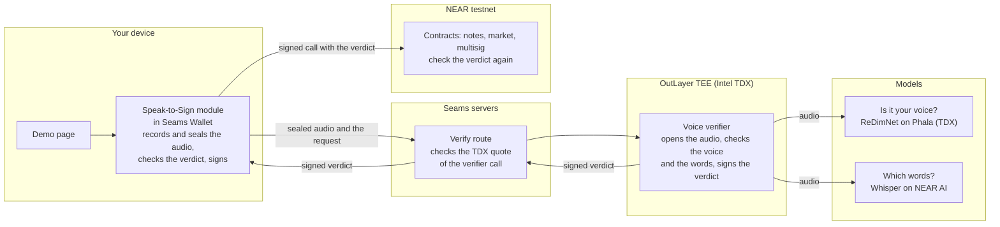
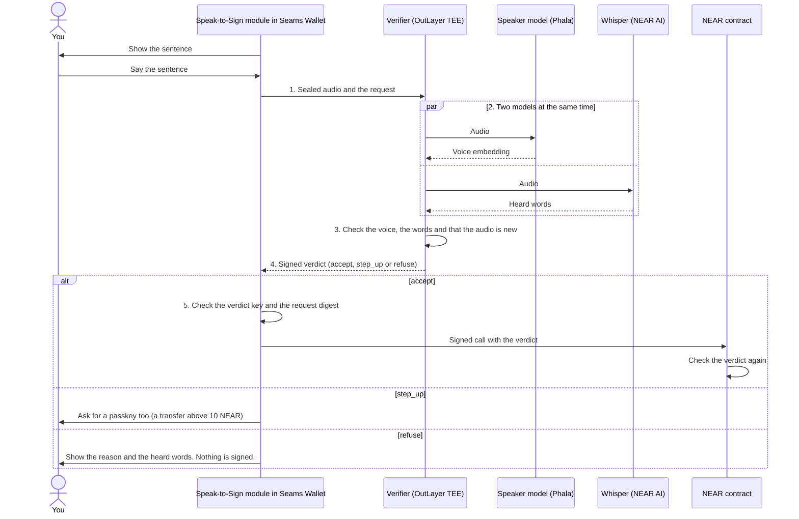

# Speak-to-Sign

**Approve a blockchain call by saying it.**

You say one sentence, for example "Send 2 NEAR to alice.testnet". A verifier
in a TEE (a sealed part of a processor, which the hardware can prove) checks
two things: the voice is yours, and the words are that exact call. Only then
does the wallet sign. The contract checks the verifier's signed verdict again
on chain. So a changed web page or a prompt-injected agent cannot make you
sign a call that you did not say.

We call this a **Confidential Voice Intent**: Speak-to-Sign turns speech
into a signed intent. Your device seals the recording to a key that exists
only inside the verifier's TEE, and the TEE signs who spoke and what they
said.

Speak-to-Sign is an entry for the NEAR hackathon. It runs on NEAR testnet
only.

| Start here | |
| --- | --- |
| Try it | <https://speak-to-sign.pages.dev/>, on a laptop with a microphone. It takes about 2 minutes. |
| Judges | [`JUDGES.md`](JUDGES.md): the short path to see it work and to check each claim. |
| Demo video | [The demo video](https://x.com/lowerarchy/status/2121206041337835883), in the first post of the thread on X. It is one take of 1 min 50 s. |
| X post | [The thread on X](https://x.com/lowerarchy/status/2121206041337835883): the demo, how it works, a refusal, and other uses. |
| AI reviewers | [`AGENTS.md`](AGENTS.md): the read order and the facts that are easy to miss. |

## Contents

- [What you can do by voice](#what-you-can-do-by-voice)
- [Try it in 2 minutes](#try-it-in-2-minutes)
- [How it works](#how-it-works)
- [Why sign by voice](#why-sign-by-voice)
- [Check it yourself](#check-it-yourself)
- [Testnet facts](#testnet-facts)
- [Trust limits](#trust-limits)
- [Baseline and hackathon work](#baseline-and-hackathon-work)
- [Repository](#repository)
- [Built with](#built-with)
- [More to read](#more-to-read)

## What you can do by voice

The demo is community notes on a voice-controlled X.com-style page. The same
voice verifier also approves payments and multisig transfers.

| You do this | You say | What checks it |
| --- | --- | --- |
| Post a community note | A short summary of the note. | The verifier, Wallet core, and the contract `notes.seams-v1.testnet` |
| Rate a note | "This note is helpful" | The same |
| Bet on a note | "Bet 0.5 USDC yes on market 12" | The verifier, and the market contract `pm-notes.seams-v1.testnet`, which takes the USDC only with a verdict for that bettor, market, side and amount |
| Pay someone (the page [`demo/speak-to-pay`](demo/speak-to-pay/), which you run on your machine) | "Send 2 NEAR to alice.testnet" | The verifier and the Wallet. Above 10 NEAR, a passkey too. |

In the voice bar, JEV, an AI classifier, turns your words into a command (the
post, the side and the amount) and opens the correct sheet. JEV never
proposes or signs a payment. You approve the exact call when you say it.

The spoken multisig is for its 2 signers, not for a visitor, and you do not
need it to try the demo. As evidence that it works: on 2026-11-12 two persons
proposed, approved and executed one transfer by voice
([the live run](demo/contracts/voice-multisig/README.md#live-run-on-testnet)).

## Try it in 2 minutes

You need a browser with passkeys and a microphone.

1. Open <https://speak-to-sign.pages.dev/>.
2. Do the three setup steps on the page: create a wallet (a passkey), set up
   your voice (three short clips), and get testnet NEAR and USDC (the
   faucet).
3. Use it with no hands. Turn on the voice bar at the foot of the timeline
   (**Turn voice commands on**), and say "show me the open markets", then
   "bet one dollar on no on the second note". The bet sheet opens. Read the
   bet aloud, and the market contract takes the USDC.
4. Or use the buttons: on a post, press **Write a note** and read the summary
   aloud, or press **Bet** and read the bet aloud.
5. To see a refusal, read other words, or add or drop a "not". The card shows
   the reason and the words that the verifier heard. Nothing is signed.

[`JUDGES.md`, "See it in 2 minutes"](JUDGES.md#see-it-in-2-minutes) has each
step with the voice commands. To run the demo on your own computer with no
account and no secret key, run `pnpm site` (the notes app) or
`pnpm pay` (Speak to pay): see
[`demo/frontend/README.md`](demo/frontend/README.md#run-it-locally) and
[`demo/speak-to-pay/README.md`](demo/speak-to-pay/README.md#1-run-it-locally).

## How it works

### The parts

Each box is a part, and each group is a place that runs it. The audio leaves
your device only sealed to the verifier.



### One approval, step by step



The numbers in the diagram are these steps:

1. The Wallet records you and sends the audio and the typed request to the
   verifier, an OutLayer WASM worker (`seams-v1.testnet/voice-verifier`).
2. The verifier asks two models at the same time: a speaker model on Phala
   compares the voice with the voice that you enrolled, and Whisper on NEAR
   AI gives the words.
3. The verifier checks the heard words against the sentence of the request.
   It refuses words that add or drop a "not", and it refuses a recording that
   was used before.
4. The verifier signs a verdict. The verdict binds the speaker, the heard
   words and the digest of the exact request. It expires after 120 s.
5. Wallet core checks the verdict against a pinned key, then signs the call
   from your own account. The contract checks the verdict again on chain, so
   a bot with a plain NEAR key cannot skip the voice step over RPC.

The audio is sealed. The device seals each recording to a key that exists
only inside the OutLayer TEE, and the servers between them carry ciphertext.
The verifier opens it and sends it to two services. The speaker service is a
Phala TDX VM with a pinned key. For NEAR AI Whisper, the verifier (0.14.1)
checks the Intel TDX quotes of NEAR AI's gateway and of Whisper inside the
worker. Then it sends the recording with Oblivious HTTP (HPKE), sealed to the
key of the checked gateway, so the server that ends the TLS connection sees
only ciphertext ([details](docs/trust-chain.md#the-near-ai-check)). The quote
check is our own small TDX verifier, with no large library: the whole worker
is 495,774 bytes, less than the version before it. While NEAR AI's Whisper
is down, the Seams staging server and the demo route select the `venice`
build on Venice AI, which has no TEE ([state](docs/deployed-state.md#the-verifier)).

The formats and the rules are in
[`docs/voice-intents-spec.md`](docs/voice-intents-spec.md).
[`docs/architecture.md`](docs/architecture.md) has the detailed diagrams:
enrollment, the decision in the verifier, what a verdict binds, the voice
multisig, the trust boundaries and the path of the audio.

## Why sign by voice

- **No blind signing.** A passkey click shows that a device approved
  something, not what the person agreed to. Here the Wallet signs only when
  the spoken words match the request, so the words of a phishing request do
  not match.
- **The loss that this stops.** On 21 February 2025, attackers took about
  US$1.5 billion from Bybit. They changed the Safe{Wallet} web page, so the
  multisig signers saw a normal transfer and signed a transaction that gave
  the attackers control. Here each signer says the request, and the verifier
  checks the heard words against the request that is signed. If a changed
  page shows other words, the words do not match, and the verifier refuses.
- **AI drafts and routes, and you approve.** NEAR AI drafts the note, and JEV
  routes your command. Neither can approve a call. Only your spoken sentence
  can.
- **One sentence is the approval, checked at two layers.** Off chain, the
  Seams verify route checks the TDX quote of the verifier call against the
  pinned WASM hash at 0 gas, and Wallet core and the Seams co-signer check the
  verdict before they sign. They guard native NEAR transfers. On chain,
  `notes`, `pm-notes` and `voice-multisig` check the ed25519 verdict again, so
  a bot with a plain NEAR key cannot skip the voice step over RPC
  ([who checks the verdict](docs/voice-intents-spec.md#9-who-checks-the-verdict)).
- **A voice clone alone signs nothing.** It works only on the person's own
  device, with the Wallet unlocked (see [Trust limits](#trust-limits)).

**How it differs.** Many entries guard agent spending with caps, policies or
an AI judge, and a large payment waits for a tap. Here the approval itself is
the spoken exact call ([`JUDGES.md`, "How it differs"](JUDGES.md#how-it-differs)).
[`docs/judge-questions.md`](docs/judge-questions.md) answers the doubts of a
strict review: voice clones, a compromised page or agent, JEV, spend guards
and who controls the verifier.

## Check it yourself

You can check the claims from a terminal, with no NEAR account and no keys.

| Step | What it proves |
| --- | --- |
| 1. The sentence and the signed bytes | The sentence that you say and the digest that is signed come from one request. |
| 2. The verifier | The rules of the voice check. For example, one changed word of a summary passes, and an added or dropped "not" does not. |
| 3. The verdict check | A verdict for one request does not pass for another request, another sentence or another recording. |
| 4. The notes contract | Each rule of the contract, in unit tests and in a local sandbox. The deployed code is a reproducible build of this source. |
| 5. Live testnet facts | The accounts, the code hashes and the verifier versions that are live now. |

- [`JUDGES.md`, "Check it from a terminal"](JUDGES.md#check-it-from-a-terminal)
  is the short form: each command with one line of expected result.
- [`docs/terminal-checks.md`](docs/terminal-checks.md) is the long form: each
  command with its whole output.
- [`JUDGES.md`, "Claim -> where to check it"](JUDGES.md#claim---where-to-check-it)
  names the test or the transaction for each claim.

## Testnet facts

### Contracts

Each contract runs a reproducible build: the notes contract the build of commit
`119ef0e` and the voice multisig the build of commit `99231f6` since
2026-11-12, and the note market and the faucet the builds of commit
[`777b844`](https://github.com/seams-tech/speak-to-sign/tree/777b84429096604e77e217480e9f89a398f5da13)
since 2026-11-11. SourceScan built each one again and got the same code hash.
The account link opens the contract page of NearBlocks, which shows the code
as verified.

| Contract | Testnet account | Source | Code hash (base58) |
| -------- | --------------- | ------ | ------------------ |
| Community notes | [`notes.seams-v1.testnet`](https://testnet.nearblocks.io/address/notes.seams-v1.testnet/contract) | [`demo/contracts/community-notes/`](demo/contracts/community-notes/) at commit `119ef0e` | `724jz1XPE5sEQU8HXMXf4Ub1WWem8csJyhAKSeabtU7c` |
| Voice multisig (version 3.0.0, voice only, 2 of 2 signers) | [`voice-multisig.seams-v1.testnet`](https://testnet.nearblocks.io/address/voice-multisig.seams-v1.testnet/contract) | [`demo/contracts/voice-multisig/`](demo/contracts/voice-multisig/) at commit `99231f6` | `CkYrt1XM3NDsdd7B8PVx2eyUh36nM3nQtmvbta8eQTnA` |
| Note market | [`pm-notes.seams-v1.testnet`](https://testnet.nearblocks.io/address/pm-notes.seams-v1.testnet/contract) | [`demo/contracts/jev-prediction-market/`](demo/contracts/jev-prediction-market/) | `7qA3mFHgGa31dsUJ3BjdCuh8yHS8jnnS79aMNPmSnQ9Z` |
| Faucet | [`seams-faucet.testnet`](https://testnet.nearblocks.io/address/seams-faucet.testnet/contract) | [`demo/contracts/faucet/`](demo/contracts/faucet/) | `6d8BGwTR88jjFFaYEfhnTnLaQet2FmRE3d5DvYxefR2z` |

The live multisig run was on a second account,
[`voice-multisig-2.seams-v1.testnet`](https://testnet.nearblocks.io/address/voice-multisig-2.seams-v1.testnet),
which has the same code hash. Its signers have enrolled voices, and its
proposals are there. `voice-multisig.seams-v1.testnet` has no proposal.

The deploy transactions and the way to build each contract again are in
[`demo/contracts/README.md`](demo/contracts/README.md#the-deployed-code).

**The verifier.** The verifier is the OutLayer project
`seams-v1.testnet/voice-verifier`. Its source is
[`crates/voice-verifier/`](crates/voice-verifier/). OutLayer has no public
page for one project. The project is a record in the OutLayer contract
[`outlayer.testnet`](https://testnet.nearblocks.io/address/outlayer.testnet),
so the links below go to the transactions on that contract and to the WASM
files that run.

Its verdict key is `ed25519:E8E53ydtc9LRvVz9xBCRrSzyBa5nh1gK1ts53Aoo751U`.
The key is bound to the project, and the Wallet and the contracts pin it.

The verifier gets the heard words from Whisper on NEAR AI by default: 0.14.1
is the active version. NEAR AI's Whisper gave no reply for about 2.5 hours on
2026-11-12. For such an outage, the Seams staging server and the demo route select
the `venice` build,
which uses Whisper on Venice AI, until NEAR AI answers again.

| Version | State | WASM that runs | On chain |
| --- | --- | --- | --- |
| 0.14.1 | Active, the default: Whisper on NEAR AI. It checks the TDX quotes of NEAR AI before it sends audio there. | [`1e7c6968…8a5c`](https://test.fastfs.io/seams-v1.testnet/outlayer.testnet/1e7c6968bbfcf6d3193874d12988054114a004f7e10ccf8c1aeddfdca6d38a5c.wasm) | Added: [`AJ6excNh…Bki9`](https://testnet.nearblocks.io/txns/AJ6excNhQnY4MRkQdAxqoqNXX88yCPA2iV2oMcrfBki9). Made active: [`GnXazq3d…c6rC`](https://testnet.nearblocks.io/txns/GnXazq3d4UukDyGMm6FPGoCvrCEQhwniHKGAMr8vc6rC) |
| 0.14.1+venice | Not active (only while NEAR AI's Whisper is down): Whisper on Venice AI, which has no TEE. Proposal 3 of the live multisig run used it. | [`344b8b47…d3c8`](https://test.fastfs.io/seams-v1.testnet/outlayer.testnet/344b8b479a42de612942c2811f21e0e09462deb9c1d873dd2929b052bdabd3c8.wasm) | Added: [`7spkQGnf…u8ip`](https://testnet.nearblocks.io/txns/7spkQGnfQGbDJm8dFQnxY7MapYkk4LoDjhdZQzF5u8ip) |

The name of each WASM file is its SHA-256, and OutLayer uses that hash as the
version key. To check it, download the file and run `shasum -a 256` on it, or
build the same bytes from the source
([reproducible build](crates/voice-verifier/README.md#reproducible-build)).
OutLayer's own guide to the check of a TEE run is
[Trust and verification](https://app.outlayer.ai/docs/trust-verification).

[`docs/deployed-state.md`](docs/deployed-state.md) says what is live now, where
it differs from the source, and the command that checks each part.
The [verifier README](crates/voice-verifier/README.md#versions) has each
version with its hash and its transactions.

## Trust limits

These are the parties and the parts that you must trust today.
[`docs/threat-model.md`](docs/threat-model.md) has each attacker and what
stops it, and [`JUDGES.md`, "Not covered"](JUDGES.md#not-covered) lists what
is not done.

- **OutLayer.** The TEE run of pinned code, its storage of the template and the used audio, its signing key, and the NEAR AI secret. If OutLayer's TEE or governance fails, the verdict means nothing.
- **Project owner.** The owner of the OutLayer project can deploy a new version that signs with the same project-bound key. The Wallet pins the key, not the code.
- **NEAR AI.** Whisper does not sign a transcript, and a false transcript could pass the words check. The verifier (0.14.1) checks the Intel TDX quotes of NEAR AI's gateway and of Whisper, and it accepts only a reply that the checked gateway sealed for that request. It still trusts the code of NEAR AI's VMs and the link from the gateway to Whisper ([details](docs/trust-chain.md#the-near-ai-check)).
- **Phala.** The speaker service key comes from Phala's dstack KMS, per app ID.
- **Sealed audio after the verifier.** The verifier sends the opened recording to two services: the speaker service (a Phala TDX VM, its key pinned from its attestation), and NEAR AI Whisper, sealed to the gateway whose TDX quote the verifier checked. While NEAR AI's Whisper is down, the `venice` build of the verifier sends the recording to Whisper on Venice AI over TLS. Venice has no TEE, so Venice can read that audio. Each verdict of that build says `+venice` in its `verifier` field.
- **Contract accounts.** Each of the four demo contract accounts still has a full-access key. Its holder can deploy new code, or name another moderator of the notes contract.
- **Seams Wallet.** Seams Wallet is an embedded wallet with threshold signing. It existed before the hackathon, and Speak-to-Sign uses it as a dependency. The device and the Seams co-signer sign each call jointly, so neither can sign alone. A native NEAR payment has no contract that checks the verdict: the Wallet and the co-signer guard it, and above 10 NEAR the verifier asks for a passkey too.
- **Voice clones.** A voice clone works only on the person's own device, with the Wallet unlocked. VoiceID runs in the Wallet's isolated iframe on that device, and the keys stay there, so on another device a clone alone cannot unlock the Wallet (see [`docs/judge-questions.md`](docs/judge-questions.md), question 2). An attacker needs that device in hand (or malware that controls it) and an unlocked Wallet, and with those, the attacker can do much more harm than a voice clone. On that device, this build has no liveness check and no fresh words, and only a NEAR transfer above 10 NEAR also needs a passkey.
- **Synthetic voices (future work).** The verifier does not detect synthetic speech yet, so a text-to-speech voice can enroll and pass. It also does not refuse one voice on many accounts. The detection of synthetic speech is future work: an anti-spoofing model that we can add to the TEE, next to the speaker check.

## Baseline and hackathon work

The hackathon project is Speak-to-Sign: the voice verifier (an OutLayer TEE
worker, with Whisper on NEAR AI Cloud and a speaker service on Phala), the
voice libraries, the demo, and the integration into Seams Wallet. All of this
repository was made in the hackathon window, from 2026-10-19 to 2026-11-14
(UTC).

Seams Wallet is a programmable embedded wallet that existed before the
hackathon. It is the baseline, not hackathon work.

- [`JUDGES.md`, "Scope of the hackathon work"](JUDGES.md#scope-of-the-hackathon-work)
  says which part is which.
- [`docs/hackathon-scope.md`](docs/hackathon-scope.md) gives the first commit
  of each part, with the command that prints it, and the diff of the Wallet
  in the window.

## Repository

```text
speak-to-sign/
├── README.md                       this page
├── JUDGES.md                       the short path for judges: see it, check each claim
├── AGENTS.md                       a guide for AI reviewers
├── crates/                         Rust
│   ├── spoken-intent/              makes the sentence and the digest of a request
│   ├── voice-verifier/             the verifier: the OutLayer TEE worker
│   ├── voice-verdict/              the check of a signed verdict, for a server or a contract
│   └── speaker-service/            the speaker model (ReDimNet) in a Phala TDX VM
├── packages/                       npm libraries for an application with no wallet
│   ├── voice-capture/              records one spoken sentence in the browser
│   ├── voice-verdict/              checks a signed verdict; seals a recording
│   └── voice-sign/                 record, call the verifier, check the verdict;
│                                   example/ is a Web2 page and server with no wallet
├── demo/                           the demo: the site, its contracts and its worker
│   ├── frontend/                   the demo site: notes, the market, /multisig/
│   ├── contracts/
│   │   ├── community-notes/        notes.seams-v1.testnet
│   │   ├── jev-prediction-market/  pm-notes.seams-v1.testnet, with its resolver
│   │   ├── voice-multisig/         the voice-only multisig, and its live run
│   │   └── faucet/                 seams-faucet.testnet
│   ├── speak-to-pay/               pay a NEAR account by voice; you run it on your machine
│   └── x-refresh-worker/           a scheduled worker that gets new posts from X
├── docs/                           the specs; docs/README.md is the index
└── scripts/                        site.mjs starts the demo apps (pnpm site, pnpm pay)
```

Most folders have a README of their own with the details.

## Built with

- Own baseline: the Seams Wallet SDK (`@seams/wallet`) and its Router A/B
  signing. The SDK package `@seams/voiceid` and the Speak-to-Sign flow in
  `@seams/wallet` were made in the window (see the table).
- Rust: `near-sdk` 5.30.1, `near-workspaces` 0.24.0 (sandbox test only),
  `outlayer` 0.2.1, `wasi` 0.13.3, `ed25519-dalek` 2, `sha2` 0.10.9, `borsh`
  1.6.1, `serde`, `serde_json`, `base64`.
- Web: React 19, Vite 8, Wrangler 4 (Cloudflare Pages).
- Services: OutLayer (TEE workers, FastFS), NEAR AI Cloud (Whisper large-v3),
  Phala dstack CVM (ReDimNet B1 speaker embeddings), NEAR testnet RPC.
- AI coding agents (Claude Code and Codex) wrote parts of the code.

## More to read

- [`docs/README.md`](docs/README.md): the index of the specs. Each document
  answers one question.
- [`crates/voice-verifier/README.md`](crates/voice-verifier/README.md): the
  verifier, its inputs and each of its versions.
- [`demo/contracts/README.md`](demo/contracts/README.md): the four contracts,
  their deploys and the reproducible build.
- [`packages/voice-sign/README.md`](packages/voice-sign/README.md): how an
  application with no wallet uses the three npm libraries.
- Design records in other Seams repositories:
  `seams-wallet/docs/refactor-227-speak-to-sign-without-passkey.md`,
  `seams-monorepo/docs/refactor-210-voice-intents.md`, and
  `seams-monorepo/docs/evidence/refactor-210-gate0/` (the Gate 0 results, the
  HTTPS latency records and the Phala speaker attestation).

The code is under the Apache License 2.0 ([`LICENSE`](LICENSE)).
