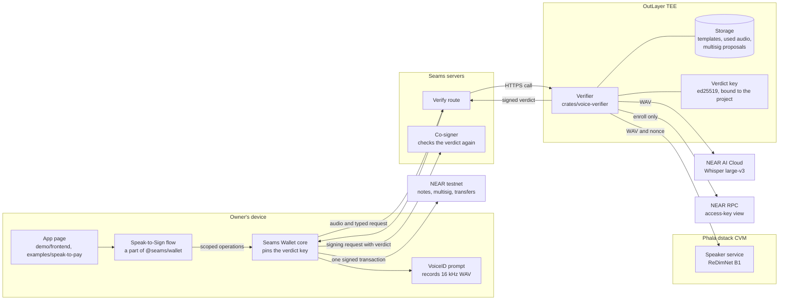
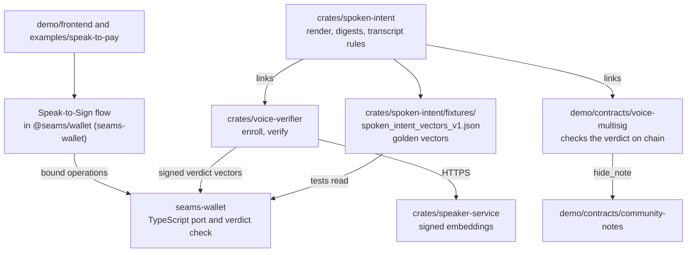
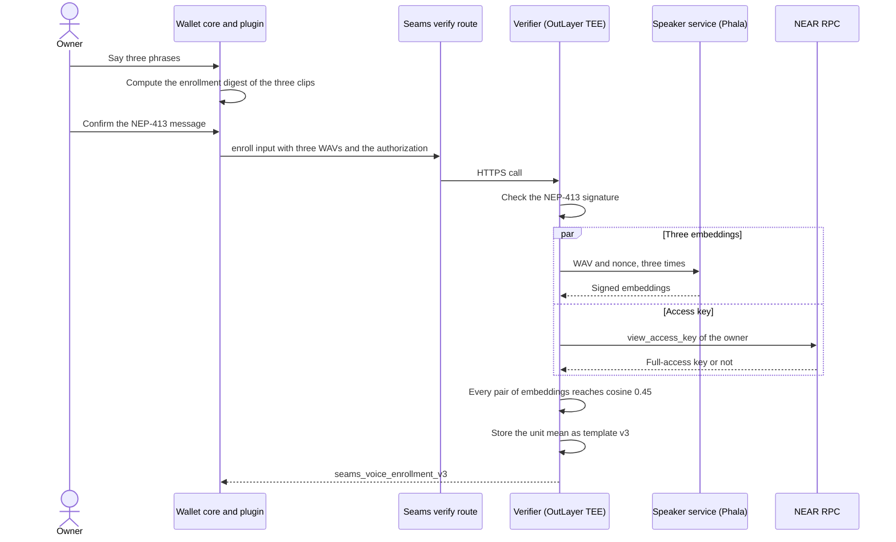
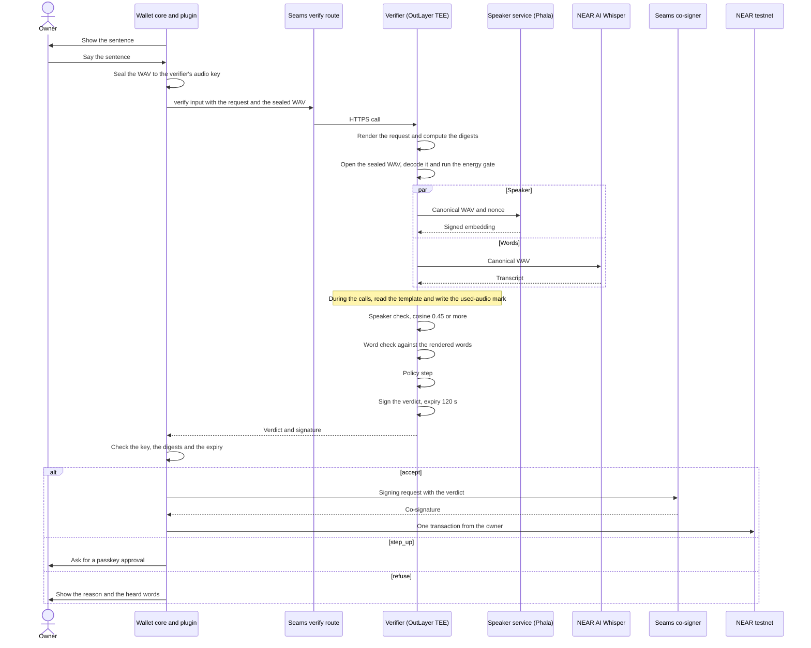
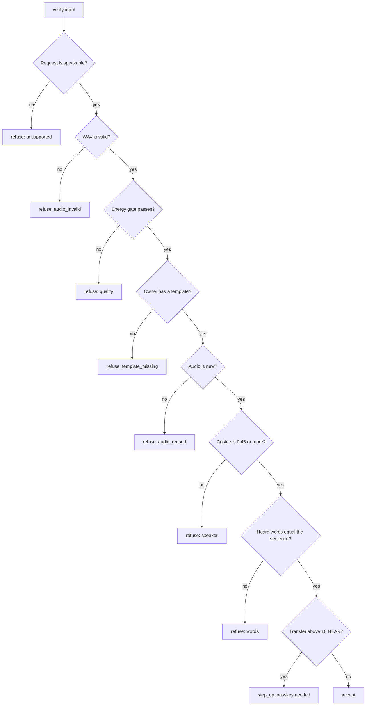
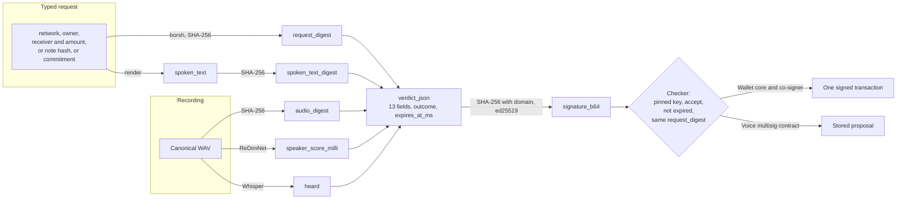
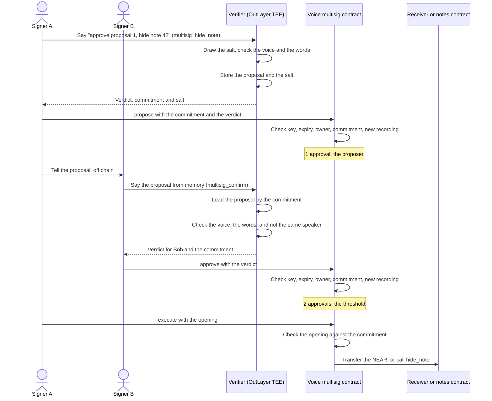
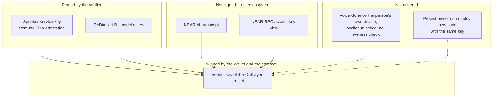
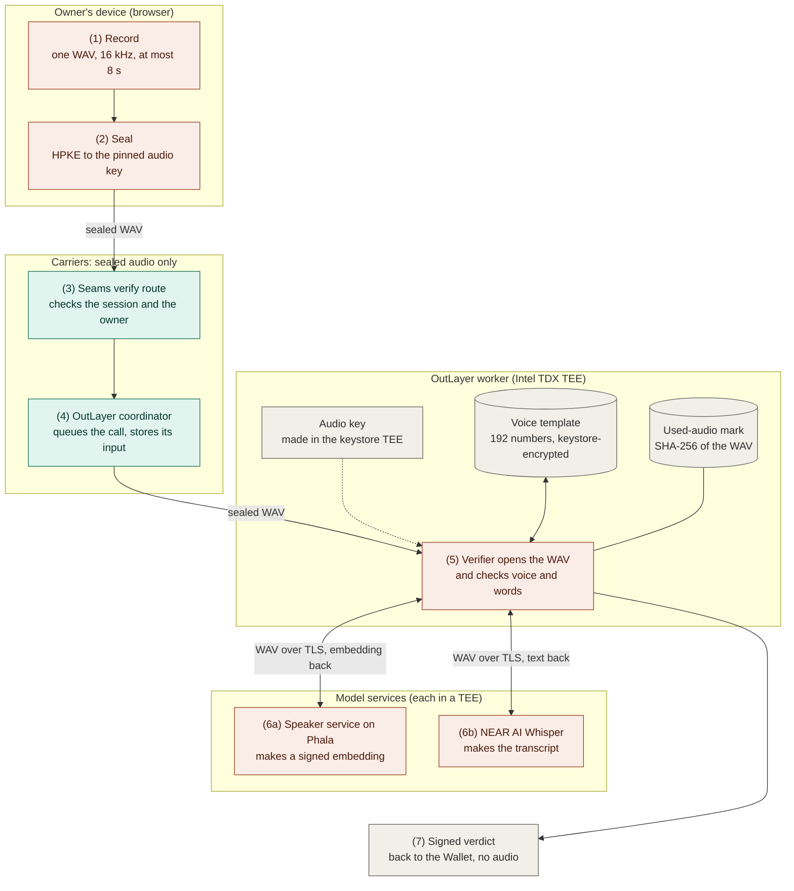

# Voice intents: architecture diagrams

These diagrams show how the parts of Speak-to-Sign work together. The rules
and the formats are in [`voice-intents-spec.md`](voice-intents-spec.md).
GitHub draws the Mermaid blocks.

## 1. System

The owner's device records the voice. The verifier runs in an OutLayer TEE
and calls two services. The Wallet signs only with a valid verdict.

## 2. Crates and packages

`spoken-intent` is the one source of the sentence and the digests. Each
other part links it or ports it.

## 3. Enrollment

The owner records three clips. A full-access key of the owner signs the
enrollment, so only the owner can set the template.

## 4. Verification

One recording, one typed request, one signed verdict. The two service calls
run at the same time, and the storage calls run while they are in flight.

## 5. Decision in the verifier

Each check can refuse. The policy step can only make the decision stricter.

Every result, also a refusal, is a signed verdict.

## 6. What a verdict binds

The verdict connects four things: the request, the words, the audio and the
time. The checker builds the request digest itself and compares.

## 7. Voice multisig demo

The contract (`demo/contracts/voice-multisig`, version 3.0.0) is voice only:
M of N signers, no admin. It checks each verdict on chain, for `propose` and
for each `approve`. The chain holds only the commitment until `execute`.
Version 3.0.0 is on `voice-multisig.seams-v1.testnet` (2 of 2 signers), and
no demo page drives it yet. The diagram shows 2 of N signers.

## 8. Trust boundaries

Each box is a party that the design trusts for one thing.

### 8.1 The verdict key, the build and the TDX quote

Decided on 2026-11-12. Read this section before you plan a change to how a
verdict is trusted.

**The key does not name the build.** The verdict key is a keystore signing
key with `bind: "project"` (`signing_keys` in
`crates/voice-verifier/manifest/outlayer.json`). The keystore gives it to
every version of the project. On 2026-11-12 the project
`seams-v1.testnet/voice-verifier` had 24 versions (`list_versions` of
`outlayer.testnet`). So a valid signature means "a version of this project
signed". The project owner can add a version that signs any verdict.

**The TDX quote of the call names the build.** The first 32 bytes of the
report data are the task hash over the WASM hash, the input hash, the output
hash, the caller, the project and the time
([standalone-library.md](standalone-library.md), section 4.3). The verdict
is in the output. So the chain is: verdict, output, task hash, quote, Intel;
and WASM hash, reproducible build, source. The key is not in this chain.

**Rule: the party that acts on a verdict checks the quote of its call.** The
party that calls the verifier gets the output and the attestation URL of the
call. Before it acts on the verdict, it checks the quote against the WASM
hashes that it accepts. Then a new version in the project cannot approve
anything: its quote names another WASM hash. The key check stays as a second
check.

**The checks:**

| Where | What it checks |
| --- | --- |
| `@seams/voice-verdict` (`packages/voice-verdict`) | `checkAttestationBinding`: the quote binds the output to an accepted WASM hash. `checkQuoteSignature` and `checkQuoteCollateral`: the quote chains to the Intel root, with Intel's collateral. `measurementsApproved`: `worker.outlayer.testnet` approves the worker image. |
| `crates/voice-verdict` (Rust) | `check_attestation_binding`, for a server. The Intel chain is a test with `dcap-qvl`. The contracts use this crate for the key check only, not for the quote. |
| `@seams/voice-sign` | The `attestation` setting runs `checkAttestationBinding` and `measurementsApproved` for each call. It does not check the signature chain of the quote to Intel, so there the quote is only a claim of the OutLayer API. |

**The contracts do not need the quote.** Each voice action of
`voice-multisig`, `jev-prediction-market` and `community-notes` is a
transaction from the user's own account (the predecessor). The wallet that
signs it is the party that checks the quote. To misuse the key on chain, an
attacker needs a bad build and the account key. The account key alone
already moves the funds. So the key check in the contracts is a second
layer, and it stays.

**On-chain DCAP is not used.** NEAR testnet has a DCAP verifier,
`tee-verifier-2026-07-22.testnet` (`crates/tee-verifier` of `near/mpc`). One
check uses about 176 Tgas (0.018 NEAR) and about 30 KB of arguments. It
proves the build to the chain with no trusted party off chain. That is
necessary only if no trusted signer is in front of the contract, for example
a contract that pays any account that submits a proof. No Speak-to-Sign
contract is like that.

**These options do not work. Do not try them again:**

- A registry that checks the quote of the key once. A `bind: "project"` key
  signs for every version, and the owner can add a version, use it and
  remove it between two checks.
- A key for each build with `bind: "wasm"`. OutLayer gives it only to a
  direct run of a WASM URL. That run has no HTTPS route ("HTTPS API only
  works for Project source") and no project storage.
- A `PROTECTED_` secret locked to one build (`outlayer secrets set
  --build`). The owner can lock the row to another build, with the same gap
  as the registry.

**With the quote check, the design still trusts:** the party that runs the
check, Intel TDX and its collateral, and the OutLayer worker image that
`worker.outlayer.testnet` approves. A verdict from a call that skipped the
check, for example a direct call with the payment key, gets the key check
only. The speaker service key and the NEAR AI transcript are separate items
of this section.

**The record wait.** OutLayer stores the attestation record a short time
after the call returns. A checker tries once each second, up to 15 s, and
that wait adds to each spoken approval. It is not measured on testnet yet.

**The wallet of the demo.** The demo signs with Seams Wallet, a threshold
embedded wallet. Its server's verify route runs the four checks against the
pinned WASM hash before it returns a verdict, and refuses with
`attestation_<code>` (`seams-wallet` commit `0b297e976`,
`speakToSignAttestation.ts`). Its co-signer checks only the key.

## 9. Confidential audio

A recording is sealed on the owner's device and opened only inside a TEE.
The servers between them carry ciphertext. Verifier 0.12.0 and later; the
rules are in section 5.1 of the specification.

Orange boxes hold the plain recording. Green boxes hold only the sealed
recording. Grey boxes hold no audio.

| Step | Place | Form of the recording |
| --- | --- | --- |
| 1. Record | The VoiceID surface of the Wallet, in the browser | Plain, in memory |
| 2. Seal | Wallet core, with `sealAudio` of `@seams/voice-verdict` | Plain in, sealed out |
| 3. Seams verify route | The Seams server | Sealed |
| 4. OutLayer coordinator | OutLayer's API and its call record | Sealed |
| 5. Verifier | The OutLayer worker, inside its TEE | Plain, only for this run |
| 6a. Speaker service | A Phala dstack confidential VM (Intel TDX) | Plain, sent over TLS |
| 6b. NEAR AI Whisper | NEAR AI Cloud | Plain, sent over TLS |
| 7. Verdict | Back through the same servers | No audio |

What is kept after a run:

- **The voice template.** One embedding of 192 numbers for each owner, made
  from three enrollment recordings. It is in the worker storage under
  `template:v3:<owner>`, encrypted by the OutLayer keystore.
- **The used-audio mark.** The SHA-256 of each recording that the verifier
  saw, so that no recording passes twice.
- **No audio.** The verifier keeps no recording. It compares the embedding of
  a request with the template and then drops it.

Who holds which key:

- **The audio key.** An X25519 key pair. The OutLayer keystore made the
  private key inside its TEE as the secret `PROTECTED_AUDIO_KEY`, and gives it
  only to a run of this project. The Wallet pins the public key in its code.
- **The seal.** HPKE base mode with X25519, HKDF-SHA256 and
  ChaCha20-Poly1305. Each recording has a new ephemeral key. The operation
  and the owner are in the `aad`, so a sealed recording opens only for that
  owner and that operation (`verify`, `enroll`, `select`, `transcribe` or
  `detect`).

Limits:

- **Who opens the recording after the verifier.** Only TEEs: the speaker
  service in a Phala dstack VM (Intel TDX), and NEAR AI's gateway and
  Whisper, each in an Intel TDX VM on dstack (the report of the Whisper VM
  also has NVIDIA GPU evidence; nobody here checks it). The verifier pins the
  key of the Phala service from its TDX attestation. It does not check NEAR
  AI's attestation: it sends the recording over HTTPS. The TLS key of
  `cloud-api.near.ai` is the key that the gateway's TDX quote names
  (`JUDGES.md`, check 5), but the verifier does not check it. Not checked:
  the code that NEAR AI's VMs run, and how the gateway reaches Whisper.
- **The request is not secret.** The Wallet sends the request fields in plain
  text, and the verdict names the heard words.
- **The project owner.** A new verifier version of the same OutLayer project
  gets the audio key. The OutLayer access rule "One build only" limits the
  key to one WASM hash; it is not set.
- **Older Wallets.** `@seams/wallet` 0.66.0 on npm sends a plain WAV.
  `@seams/wallet` 0.69.2, which the demo pins, has the seal
  (`audio_sealed_b64`).
