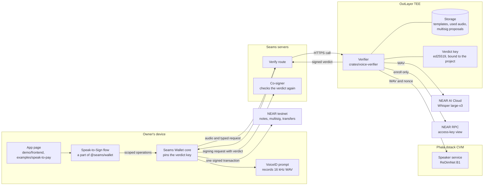
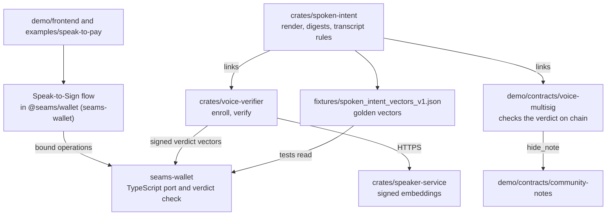
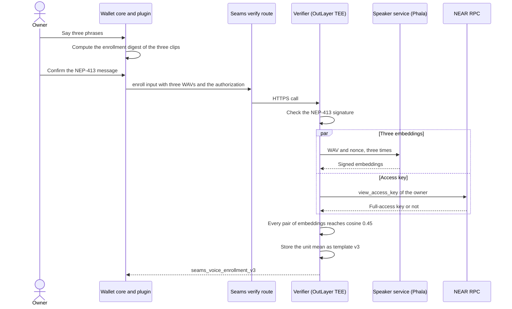
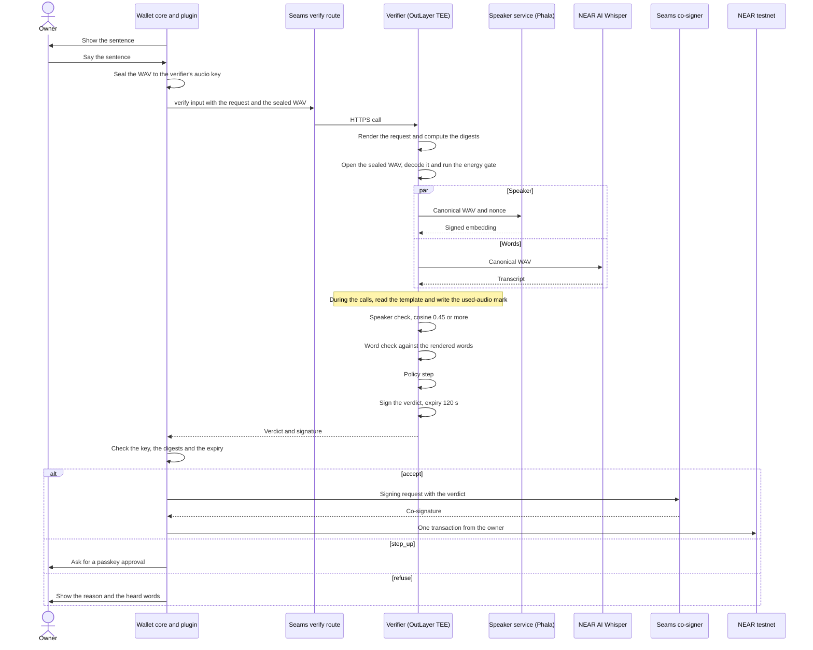
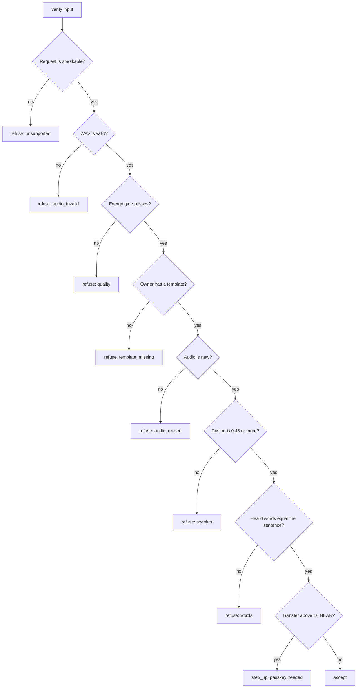
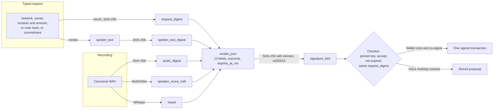
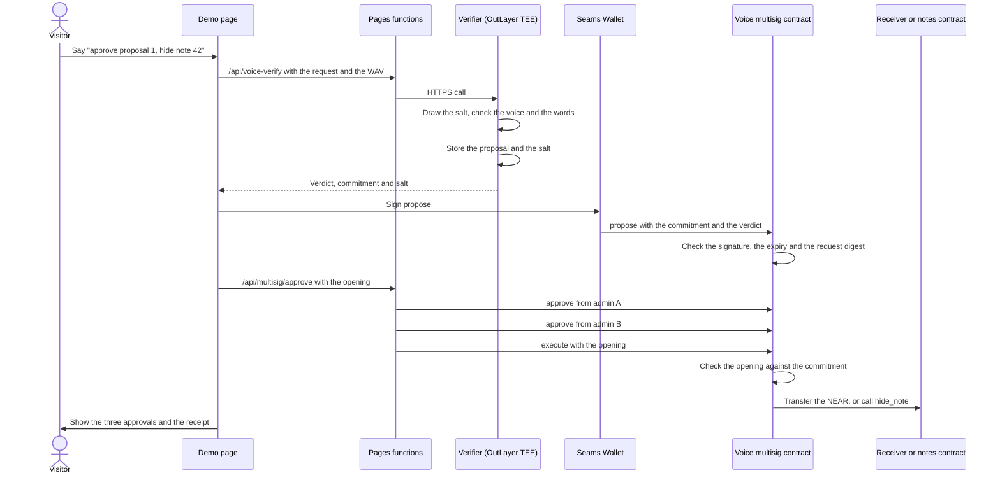
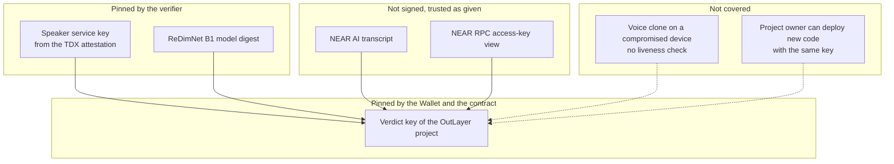
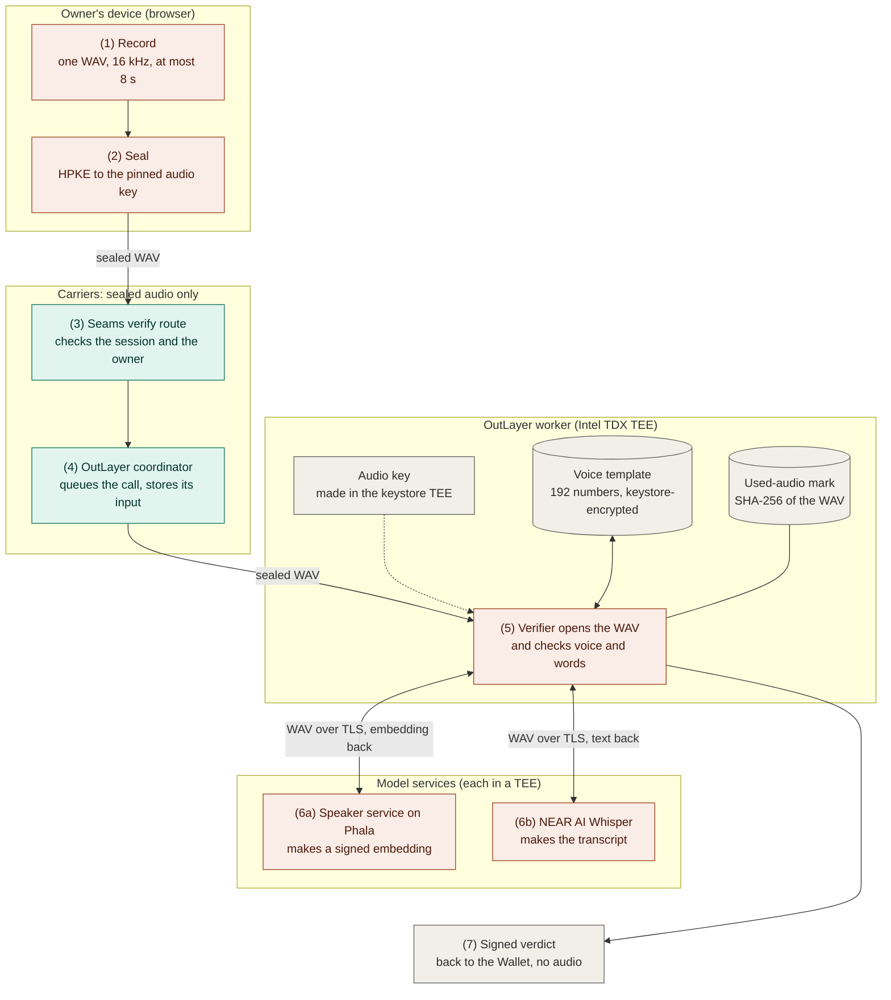

# Voice intents: architecture diagrams

These diagrams show how the parts of Speak-to-Sign work together. The rules
and the formats are in [`voice-intents-spec.md`](voice-intents-spec.md).
GitHub draws the Mermaid blocks.

## 1. System

The owner's device records the voice. The verifier runs in an OutLayer TEE
and calls two services. The Wallet signs only with a valid verdict.

## 2. Crates and packages

`spoken-intent` is the one source of the sentence and the digests. Each
other part links it or ports it.

## 3. Enrollment

The owner records three clips. A full-access key of the owner signs the
enrollment, so only the owner can set the template.

## 4. Verification

One recording, one typed request, one signed verdict. The two service calls
run at the same time, and the storage calls run while they are in flight.

## 5. Decision in the verifier

Each check can refuse. The policy step can only make the decision stricter.

Every result, also a refusal, is a signed verdict.

## 6. What a verdict binds

The verdict connects four things: the request, the words, the audio and the
time. The checker builds the request digest itself and compares.

## 7. Voice multisig demo

The contract checks the verdict on chain. The chain holds only the
commitment until `execute`.

## 8. Trust boundaries

Each box is a party that the design trusts for one thing.

## 9. Confidential audio

A recording is sealed on the owner's device and opened only inside a TEE.
The servers between them carry ciphertext. Verifier 0.12.0 and later; the
rules are in section 5.1 of the specification.

Orange boxes hold the plain recording. Green boxes hold only the sealed
recording. Grey boxes hold no audio.

| Step | Place | Form of the recording |
| --- | --- | --- |
| 1. Record | The VoiceID surface of the Wallet, in the browser | Plain, in memory |
| 2. Seal | Wallet core, with `sealAudio` of `@seams/voice-verdict` | Plain in, sealed out |
| 3. Seams verify route | The Seams server | Sealed |
| 4. OutLayer coordinator | OutLayer's API and its call record | Sealed |
| 5. Verifier | The OutLayer worker, inside its TEE | Plain, only for this run |
| 6a. Speaker service | A Phala dstack confidential VM (Intel TDX) | Plain, sent over TLS |
| 6b. NEAR AI Whisper | NEAR AI Cloud | Plain, sent over TLS |
| 7. Verdict | Back through the same servers | No audio |

What is kept after a run:

- **The voice template.** One embedding of 192 numbers for each owner, made
  from three enrollment recordings. It is in the worker storage under
  `template:v3:<owner>`, encrypted by the OutLayer keystore.
- **The used-audio mark.** The SHA-256 of each recording that the verifier
  saw, so that no recording passes twice.
- **No audio.** The verifier keeps no recording. It compares the embedding of
  a request with the template and then drops it.

Who holds which key:

- **The audio key.** An X25519 key pair. The OutLayer keystore made the
  private key inside its TEE as the secret `PROTECTED_AUDIO_KEY`, and gives it
  only to a run of this project. The Wallet pins the public key in its code.
- **The seal.** HPKE base mode with X25519, HKDF-SHA256 and
  ChaCha20-Poly1305. Each recording has a new ephemeral key. The operation
  and the owner are in the `aad`, so a sealed recording opens only for that
  owner's `verify` or `enroll`.

Limits:

- **The two model services see the recording.** The verifier pins the key of
  the Phala service from its TDX attestation. NEAR AI Cloud states that its
  inference runs in a TEE; the verifier does not check an attestation of
  NEAR AI.
- **The request is not secret.** The Wallet sends the request fields in plain
  text, and the verdict names the heard words.
- **The project owner.** A new verifier version of the same OutLayer project
  gets the audio key. The OutLayer access rule "One build only" limits the
  key to one WASM hash; it is not set.
- **The released Wallet.** Wallet core seals on `dev` of `seams-wallet`.
  `@seams/wallet` 0.66.0 on npm sends a plain WAV.
